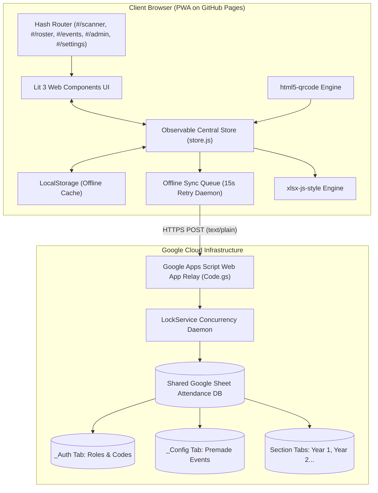

# NWU UAPSA QR Code Attendance System
### Modular, Serverless, Real-Time Attendance Scanner & Roster Manager

[](https://binting16.github.io/)
[](https://lit.dev/)
[](https://script.google.com/)
[](#license)

A high-performance attendance tracking web application built specifically for academic organizations, university departments, and student councils. Runs as a **100% serverless, zero-build Progressive Web App (PWA)** hosted on **GitHub Pages**, backed by a shared **Google Sheet** via an Apps Script relay.

> **Production Deployment:** [https://binting16.github.io/](https://binting16.github.io/)

---

## Table of Contents
1. [System Architecture & How It Works](#1-system-architecture--how-it-works)
   - [Core Design Principles](#core-design-principles)
   - [Architecture Diagram](#architecture-diagram)
   - [State Store & Reactivity](#state-store--reactivity)
   - [Dual-Tier Authorization Model](#dual-tier-authorization-model)
   - [Google Sheets Relay Mechanics & Protocol](#google-sheets-relay-mechanics--protocol)
   - [Offline-First Sync Engine](#offline-first-sync-engine)
2. [Step-by-Step Setup Guide](#2-step-by-step-setup-guide)
   - [Prerequisites](#prerequisites)
   - [Step 1: Setting up the Google Sheet & Apps Script](#step-1-setting-up-the-google-sheet--apps-script)
   - [Step 2: Deploying the Apps Script Web App](#step-2-deploying-the-apps-script-web-app)
   - [Step 3: Connecting the App to Your Sheet](#step-3-connecting-the-app-to-your-sheet)
   - [Step 4: Unlocking Secretary (Admin) Privileges](#step-4-unlocking-secretary-admin-privileges)
3. [Deployment Guide](#3-deployment-guide)
   - [Deploying to GitHub Pages](#deploying-to-github-pages)
   - [Zero-Build Static Hosting (Native ES Modules)](#zero-build-static-hosting-native-es-modules)
   - [Offline Assets & CDN Fallback Strategy](#offline-assets--cdn-fallback-strategy)
   - [Installing as a Progressive Web App (PWA / Mobile Home Screen)](#installing-as-a-progressive-web-app-pwa--mobile-home-screen)
   - [Android Native Wrapper Bridge](#android-native-wrapper-bridge)
4. [User Guide & Workflows](#4-user-guide--workfloes)
   - [Workflow A: Secretary (Admin) Operations](#workflow-a-secretary-admin-operations)
     - [Importing Student Rosters](#importing-student-rosters)
     - [Configuring Premade Events (Clean Columns)](#configuring-premade-events-clean-columns)
     - [Generating Representative Invite Codes](#generating-representative-invite-codes)
     - [Column Maintenance & Cell Adjustments](#column-maintenance--cell-adjustments)
     - [Exporting Formatted Excel Workbooks](#exporting-formatted-excel-workbooks)
   - [Workflow B: Scanner (Representative) Operations](#workflow-b-scanner-representative-operations)
     - [Redeeming an Invite Code](#redeeming-an-invite-code)
     - [Selecting Today's Session](#selecting-todays-session)
     - [Camera-based QR Code Scanning](#camera-based-qr-code-scanning)
     - [Hardware USB Barcode / QR Gun Scanner](#hardware-usb-barcode--qr-gun-scanner)
     - [Manual Student ID Fallback & Unrecognized Students](#manual-student-id-fallback--unrecognized-students)
     - [Cross-Section Live Search](#cross-section-live-search)
5. [Directory & File Structure](#5-directory--file-structure)
6. [Troubleshooting & FAQ](#6-troubleshooting--faq)

---

## 1. System Architecture & How It Works

### Core Design Principles
* **Zero Backend Hosting Costs:** Uses free GitHub Pages static hosting combined with free Google Drive/Sheets infrastructure.
* **Zero-Build Toolchain:** Built with native modern ES Modules (`<script type="module">`) and browser-native Web Components (via **Lit 3**). No `npm install`, Webpack, or Vite build pipelines required on the local machine.
* **Separation of Concerns:** Decomposed from a legacy 4,000-line single file into modular components, reactive services, and dedicated views.
* **Clean Data Integrity:** Solves chaotic spreadsheet columns by enforcing an **Event Registry** where scanners pick from validated presets rather than typing freeform headers.
* **Offline-Resilient:** Writes locally immediately for sub-second scanning latency; batches and auto-retries remote sync in the background.

### Architecture Diagram



### State Store & Reactivity
The state is managed centrally in [`src/state/store.js`](src/state/store.js) using an **Observable Subscriber Pattern**:
1. Any view or service can read the current state via `store.getState()`.
2. Any component can subscribe to state mutations with `store.subscribe(callback)`. When `store.update(fn)` or actions are called, all registered components re-render their reactive Lit templates surgically without full-page reloads.
3. Every state change is automatically mirrored to browser `localStorage` (`qrAttendanceApp_v2`). The store also includes an automatic migration layer that detects and transitions older `qrAttendanceApp_v1` formats without data loss.

### Dual-Tier Authorization Model
The system enforces role-based access control (RBAC) at two levels:

```
                          ┌───────────────────────────┐
                          │   Access Authentication   │
                          └─────────────┬─────────────┘
                                        │
                    ┌───────────────────┴───────────────────┐
                    ▼                                       ▼
        ┌───────────────────────┐               ┌───────────────────────┐
        │   Secretary (ADMIN)   │               │  Scanner (REPRESENTATIVE)
        └───────────┬───────────┘               └───────────┬───────────┘
                    │                                       │
     Full Permissions:                       Restricted Permissions:
     • Create/edit event presets             • Scan QR / Barcodes
     • Delete columns / purge cells          • Pick active premade event
     • Import rosters & add students         • Search roster & view absentees
     • Generate invite codes                 • Submit manual ID if QR unreadable
     • Full Excel exports                    • Read-only log access
```

1. **Client-Side UI Gating:** Destructive controls (e.g. column delete buttons, manual cell timestamp overrides, roster import buttons) are conditionally removed from the DOM for non-admin sessions.
2. **Server-Side Apps Script Enforcement:** The Google Apps Script relay (`Code.gs`) validates administrative tokens for privileged actions (`deleteColumn`, `clearCell`, `setEventPreset`, `addStudent`, `deleteStudent`). Forged network requests from unauthorized users are rejected with `403 Forbidden`.

### Google Sheets Relay Mechanics & Protocol
* **CORS-Free Protocol:** Browsers normally execute HTTP `OPTIONS` preflight requests on cross-origin `POST` operations. Google Apps Script Web Apps do not support HTTP `OPTIONS`. To circumvent this without proxy servers, requests are sent as `Content-Type: text/plain;charset=utf-8`. The Apps Script backend parses the body as JSON via `JSON.parse(e.postData.contents)`.
* **LockService Concurrency:** When multiple student representatives scan at the exact same second, race conditions could cause cell overwrites. The relay executes `LockService.getScriptLock().tryLock(15000)`, serializing write transactions to guarantee zero dropped or corrupted rows.
* **Spreadsheet Structure:**
  * **Section Tabs:** Each sheet tab represents a cohort (e.g., `Year 1`, `Year 2`, `Officers`).
  * **Row 1:** Merged event title banners (e.g., `Intramurals 2026 Day 1` spanning across AM and PM).
  * **Row 2:** Column headers: `Name`, `Student ID`, then `<Date> (<Period>) - Time In` and `<Date> (<Period>) - Time Out`.
  * **Row 3+:** Student records.
  * **Control Tabs (`_Config`, `_Auth`):** Hidden system tabs holding standardized event presets and authorized invite codes.

### Offline-First Sync Engine
1. When a student scans their QR code, `store.recordScan()` immediately saves the timestamp locally, triggers the success audio chime, updates the UI, and renders the flash banner.
2. If online and connected to Google Sheets, the client fires a non-blocking background `POST` request to Apps Script.
3. If the network drops or Apps Script times out, the payload is placed into `state.pendingSync` in `localStorage`.
4. [`src/services/sync-queue.js`](src/services/sync-queue.js) runs a background daemon every 15 seconds. Once connectivity returns, it automatically replays all queued records without user intervention.

---

## 2. Step-by-Step Setup Guide

### Prerequisites
* A modern browser with camera support (Google Chrome, Safari, Edge, Firefox, Brave).
* A standard Google account (personal or institutional, e.g. `@nwu.edu.ph`).
* A desktop or mobile device.

---

### Step 1: Setting up the Google Sheet & Apps Script
1. Go to [Google Sheets](https://sheets.new) and create a fresh spreadsheet.
2. Rename the spreadsheet to something identifiable (e.g., `NWU UAPSA Attendance 2026-2027`).
3. In the top menu, navigate to **Extensions → Apps Script**.
4. In the Apps Script code editor, delete any existing placeholder code.
5. Open [`google-apps-script/Code.gs`](google-apps-script/Code.gs) in this repository, copy its entire contents, and paste them into the Apps Script editor.
6. Click the **Save** icon (diskette) or press `Ctrl + S` (`Cmd + S`).

---

### Step 2: Deploying the Apps Script Web App
1. At the top right of the Apps Script window, click **Deploy → New deployment**.
2. Click the gear icon next to "Select type" and choose **Web app**.
3. Fill out the deployment fields:
   * **Description:** `Attendance Relay v2.0`
   * **Execute as:** **Me (`your-email@gmail.com`)** *(Crucial: allows reps to log attendance under your quota without needing their own Google logins)*.
   * **Who has access:** **Anyone** *(Crucial: allows mobile scanners to send attendance updates without complex Google OAuth dialogs)*.
4. Click **Deploy**.
5. When prompted with "Authorization required", click **Authorize access**.
6. Select your Google account.
   > *Note:* If you see "Google hasn't verified this app", click **Advanced** (bottom left), then click **Go to Untitled project (unsafe)**, and click **Allow**. This is standard for custom private Apps Scripts you write yourself.
7. Copy the generated **Web app URL**. It will look like:
   ```
   https://script.google.com/macros/s/AKfycbx.../exec
   ```

---

### Step 3: Connecting the App to Your Sheet
1. Open the Attendance Web App: [https://binting16.github.io/](https://binting16.github.io/)
2. Navigate to **Settings** (`#/settings`) via the navigation bar or top-right gear icon.
3. Under **Google Sheets Sync**, paste your copied Web App URL into the text box.
4. Tap **Save Link** or **Sync Now**.
5. The status chip in the top bar will turn from **Local** to a green **Live** badge. Your Google Sheet and client app are now securely linked.

---

### Step 4: Unlocking Secretary (Admin) Privileges
1. In the app, navigate to **Secretary / Admin** (`#/admin`).
2. Enter the default master code:
   ```
   SECRETARY2026
   ```
3. Tap **Unlock Admin Mode**.
4. You now have full access to create premade events, import student roster files, and generate representative invite codes.

---

## 3. Deployment Guide

### Deploying to GitHub Pages
To host your own copy of this attendance system on GitHub Pages:

1. **Fork or Clone:**
   ```bash
   git clone https://github.com/Binting16/NWU-UAPSA-QR-code-attendance.git
   cd NWU-UAPSA-QR-code-attendance
   ```
2. **Push to Your GitHub Repository:**
   ```bash
   git remote set-url origin https://github.com/<your-username>/<your-repo-name>.git
   git push -u origin main
   ```
3. **Enable GitHub Pages:**
   * In your repository on GitHub, go to **Settings → Pages**.
   * Under **Build and deployment → Source**, select **Deploy from a branch**.
   * Under **Branch**, select `main` and root `/(root)`.
   * Click **Save**.
4. Within 1–2 minutes, your system will be live at `https://<your-username>.github.io/<your-repo-name>/`.

---

### Zero-Build Static Hosting (Native ES Modules)
Unlike traditional web frameworks that require Node.js, `npm run build`, and Webpack, this project runs on **Native Browser ES Modules**:
* Modern browsers natively resolve `import { LitElement, html, css } from 'lit';` via the standard `<script type="importmap">` declared in [`index.html`](index.html).
* Any edits made to files in `src/` are immediately active on refresh—no compilation or transpilation delays.

### Offline Assets & CDN Fallback Strategy
To guarantee reliability during poor connectivity in university auditoriums or gyms:
* Core libraries are vendored directly in the [`lib/`](lib/) directory:
  * `lib/lit-core.min.js`: Lit 3 runtime (~5 KB gzip).
  * `lib/html5-qrcode.min.js`: Camera QR scanning library.
  * `lib/xlsx.bundle.js`: Excel spreadsheet generator.
* If any local asset fails to load, [`index.html`](index.html) features an automated dual-stage fallback script that fetches the asset from public CDNs (`unpkg`, `jsdelivr`) as a safety net.

### Installing as a Progressive Web App (PWA / Mobile Home Screen)
You can install the scanner as a standalone full-screen app on any smartphone:
* **iOS (Safari):** Open the site in Safari → tap the **Share** button (box with upward arrow) → tap **Add to Home Screen** → tap **Add**.
* **Android (Chrome):** Open the site in Chrome → tap the **three dots** menu (top right) → tap **Add to Home Screen** (or **Install App**).
* *Benefits:* Removes the browser address bar, expands vertical camera viewfinder area, and locks portrait orientation.

### Android Native Wrapper Bridge
For schools packaging this web app inside a native Android WebView app (e.g. using `WebView` in Kotlin/Java):
* The app automatically checks for `window.AndroidBridge`.
* If detected, the **Excel Export** button automatically streams base64 data to Android's native system Share Sheet (`AndroidBridge.saveAndShareFile`), allowing instant forwarding to Google Drive, Gmail, or WhatsApp.

---

## 4. User Guide & Workflows

### Workflow A: Secretary (Admin) Operations

```
Secretary Setup Flow:
[ Unlock Admin Mode ] ──► [ Import Rosters ] ──► [ Create Event Preset ] ──► [ Share Invite Code ]
```

#### Importing Student Rosters
1. Navigate to **Admin** (`#/admin`).
2. Under **Roster File Import**, click **Upload Roster File**.
3. Select an `.xlsx` or `.csv` file.
4. **Multi-Tab Spreadsheets:** If your file has multiple worksheet tabs (e.g. `1st Year`, `2nd Year`, `3rd Year`), the app automatically creates matching groups for each tab!
5. **Supported Column Layouts:**
   * `Name`, `Student ID` (Default)
   * `Student ID`, `Name`
   * `Student ID`, `Last Name`, `First Name`, `Middle Initial`
   * `Last Name`, `First Name`, `Middle Initial`, `Student ID`
   *(Split names are automatically standardized into "Last, First M.I." format).*

#### Configuring Premade Events (Clean Columns)
To prevent scanners from generating mismatched column names (e.g. "intrams", "Intramurals day 1", "Day 1 Intrams"):
1. Go to **Events** (`#/events`).
2. Click **＋ Create New Event Preset**.
3. Fill in:
   * **Event Title:** (e.g. `Architecture General Assembly`)
   * **Date:** (e.g. `2026-10-15`)
   * **Session Period:** `Morning (AM)`, `Afternoon (PM)`, or `Whole Day`
   * **Required Modes:** `Time In and Time Out`, `Time In Only`, or `Time Out Only`
4. Tap **Create & Use**. This event is now registered in the Google Sheet's `_Config` tab and immediately visible to all scanning devices.

#### Generating Representative Invite Codes
1. In **Admin** (`#/admin`), locate the **Representative Invite Codes** card.
2. The system generates an invite code (e.g., `UAPSA-REP-8492`).
3. Click **Copy** and send it to student representatives who will assist with scanning.

#### Column Maintenance & Cell Adjustments
* **Deleting an Obsolete Column:** In **Admin** (`#/admin`) or **Roster** (`#/roster`), click the **Delete (×)** button on a date column. This safely purges the column across all cohorts in both local memory and the remote Google Sheet.
* **Editing a Student's Time Cell:** In **Roster** (`#/roster`), click any recorded timestamp cell. A modal appears allowing you to edit the time (e.g., change `8:45 AM` to `8:30 AM`) or click **Clear** to mark the student absent.

#### Exporting Formatted Excel Workbooks
1. Navigate to **Roster** (`#/roster`).
2. Click the **📥 Excel** button.
3. The app exports an `.xlsx` file formatted identically to official university rosters:
   * Emerald green title banners (`#0B6E4F`).
   * Color-coded attendance cells (Soft Green `#C6EFCE` for Time In, Soft Red `#FBE7E5` for Time Out).
   * Separate worksheet tab for every student section.
   * Merged event banners for dates spanning AM and PM.
   * Automated **Absent** counter column flagging empty sessions.

---

### Workflow B: Scanner (Representative) Operations

```
Representative Scanning Flow:
[ Enter Invite Code ] ──► [ Pick Premade Event ] ──► [ Toggle In/Out ] ──► [ Scan QR / Barcode ]
```

#### Redeeming an Invite Code
1. Open the web app on your phone.
2. If prompted, enter the invite code provided by the secretary (e.g., `UAPSA-REP-8492`).
3. You are granted scanner access with safety locks enabled (you cannot delete columns or alter student registries).

#### Selecting Today's Session
1. Tap the **Event Badge** in the top bar or go to **Events** (`#/events`).
2. Tap the active event session created by the secretary.
3. The app switches to this session and returns to the scanner screen.

#### Camera-based QR Code Scanning
1. Go to **Scanner** (`#/scanner`).
2. Choose **Time In** or **Time Out** using the mode toggle buttons.
3. Tap **Start Camera**.
4. Point the camera at the student's QR code.
5. **Instant Feedback:**
   * **✅ Green Banner + Chime:** Time successfully logged! Shows student's full name, ID, section, and current absence count.
   * **🔁 Amber Banner + Double Beep:** Duplicate scan! The student already logged in/out for this exact session.
   * **⚠️ Red Banner + Error Tone:** Student ID not found in any group roster.
6. **Smart Group Auto-Switching:** If a student from `Section B` scans while you are viewing `Section A`, the app automatically locates their section, switches the visible roster tab, and logs their attendance in the right place.

#### Hardware USB Barcode / QR Gun Scanner
* For high-volume scanning at entrance gates, plug a USB barcode/QR scanner gun into a laptop or tablet via USB/OTG.
* Focus the cursor into the manual input box (`#manualInput`).
* Squeeze the scanner trigger: the scanner gun enters the student ID and automatically sends an `Enter` keystroke, submitting the record in under 200 milliseconds.

#### Manual Student ID Fallback & Unrecognized Students
* **Student's phone battery died or screen is cracked?** Type their ID manually into the entry box at the bottom of the scanner screen and tap **Submit**.
* **Student is newly transferred or not on the roster?** When an unknown ID is scanned, an **Unrecognized Student ID** dialog appears automatically. Enter their name, select their section, leave "Mark present" checked, and tap **Save Student**.

#### Cross-Section Live Search
1. Go to **Roster** (`#/roster`).
2. Type any student's name or ID into the search bar.
3. If the student is in your active group, they appear immediately in the table.
4. If they belong to another section, an **"Also found in other sections"** tray opens. Tap their name to immediately jump to their section.

---

## 5. Directory & File Structure

```
NWU-UAPSA-QR-code-attendance/
├── index.html                    # 73-line HTML5 shell with import maps & CDN fallbacks
├── README.md                     # Comprehensive documentation and manual
├── FUTURE_WORK.md                # Engineering roadmap (Dark mode, Multi-college, DB migration)
│
├── google-apps-script/
│   └── Code.gs                   # Google Sheets Relay Backend (Auth, Config, Concurrency Lock)
│
├── src/
│   ├── app-root.js               # Master Lit element mounting topbar, navigation & routes
│   ├── router.js                 # Hash-based micro-router (#/scanner, #/roster, etc.)
│   ├── config.js                 # Global constants, presets, storage keys & roles
│   │
│   ├── state/
│   │   └── store.js              # Observable reactive store, state mutations & migrations
│   │
│   ├── services/
│   │   ├── sheets-api.js         # HTTP client for Google Apps Script Web App
│   │   ├── auth-service.js       # Role determination (Admin vs Scanner) & invite tokens
│   │   ├── sync-queue.js         # Offline retry daemon running every 15 seconds
│   │   ├── audio-service.js      # Web Audio API chime synthesis & haptic vibration
│   │   └── export-service.js     # Styled Excel workbook builder & Android bridge
│   │
│   ├── components/
│   │   ├── ui-topbar.js          # Brand header, active session pill & sync indicator
│   │   ├── ui-navigation.js      # Responsive mobile bottom bar & desktop sub-nav
│   │   ├── ui-toast.js           # Ephemeral toast alert notifications
│   │   └── ui-modal.js           # Reusable accessible dialog backdrop
│   │
│   ├── views/
│   │   ├── view-scanner.js       # Camera viewfinder, mode toggle & flash result panel
│   │   ├── view-roster.js        # Matrix table, search, absent counters & cell editor
│   │   ├── view-events.js        # Premade event session launcher & preset creator
│   │   ├── view-admin.js         # Secretary console, invite code generator, roster import
│   │   └── view-settings.js      # Sheets connection, column width selector, JSON backup
│   │
│   └── styles/
│       ├── theme.css             # Root CSS custom properties, colors, metrics
│       └── shared-styles.js      # Reusable Lit CSSResult template strings
│
└── lib/                          # Vendored client libraries for 100% offline support
    ├── lit-core.min.js           # Lit 3 Core framework bundle (~5 KB gzip)
    ├── html5-qrcode.min.js       # html5-qrcode camera barcode/QR engine
    └── xlsx.bundle.js            # xlsx-js-style spreadsheet generator
```

---

## 6. Troubleshooting & FAQ

#### Q: The camera preview is black or won't start.
* **HTTPS Requirement:** Web browsers strictly block camera access unless served over **HTTPS** (or `localhost`). Check that your URL begins with `https://`.
* **iOS Safari Permissions:** Tap the `aA` icon on the left side of Safari's address bar → **Website Settings** → **Camera** → select **Allow**.
* **Another App In Use:** Ensure other apps (e.g. FaceTime, Instagram, Zoom) are not locking the camera hardware.

#### Q: Scans say "Live" but records aren't showing up in Google Sheets.
1. In the app, navigate to **Settings** (`#/settings`).
2. Verify that your Google Sheets Web App URL ends with `/exec` (NOT `/edit` or `/dev`).
3. In your Google Sheet, open **Extensions → Apps Script → Deploy → Manage deployments**. Ensure that **Who has access** is set to **Anyone**.

#### Q: What happens if the internet disconnects during an event?
Nothing is lost. The app operates **offline-first**. Scans are recorded locally in browser storage immediately and placed in an internal retry queue. When your phone reconnects to Wi-Fi or mobile data, the background sync queue replays all missed scans into the Google Sheet automatically.

#### Q: Can I run multiple devices scanning into the same spreadsheet at once?
**Yes.** Google Apps Script utilizes `LockService` to handle multi-device concurrency. For very large events, secretaries can also assign specific scanners to specific cohorts via **Settings → Restrict this device to one group**.

#### Q: How do we change the active event or start an afternoon session?
Have the secretary go to **Events** (`#/events`) and tap the afternoon (PM) event preset. All scanners simply tap that event in their list, and all subsequent scans will write cleanly into the afternoon columns.

---

## License
Distributed under the MIT License. Developed for the **Northwestern University United Architects of the Philippines Student Auxiliary (NWU-UAPSA)**. Built and maintained by Jan Vincent "Binting" Aningat.
